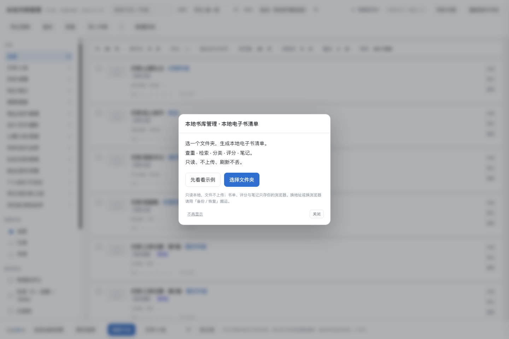

# 本地书库管理 · Ebooklib

> Turn a local ebook folder into a searchable, deduplicated catalog — entirely in your browser. Nothing is uploaded.

**Source Available · 源码可用** ｜ 单文件离线网页 ｜ 全程只读 ｜ 零上传 · 零账号 · 零后端

[在线体验](https://sinejjj.github.io/ebooklib/) · [能做什么](#能做什么) · [两种用法](#两种用法) · [快速开始](#快速开始) · [License](#license)

把本地电子书库（mobi / epub / pdf / azw3 / kfx / txt …）变成一份可检索、可查重、可分类、可打分、可记笔记的网页清单。书单、评分、笔记全部留在你自己的浏览器里。

## 界面预览


<details>
<summary>开屏引导（点击展开）</summary>



</details>

## 能做什么

- **查重**：同名副本、分卷合集、扫描图册分开处理；不同卷不会被误判成重复
- **检索 / 筛选**：书名、作者、分类、已读、我的评分、豆瓣评分、未匹配豆瓣
- **评分排序**：豆瓣评分 + 评价人数；匹配不上的书不造假数据，如实显示「未匹配」
- **个人信息**：我的五星、读了多少页、出版社、幕布笔记链接、本地短记、已读 / 标签 / 隐藏
- **搬家识别**：文件挪了位置或改了名，评分和笔记跟着走
- **导出**：阅读清单 CSV / TXT、完整备份 JSON（状态 + 全部笔记正文）
- **只读**：绝不修改、移动、重命名或删除书库里的任何文件

## 两种用法

### 在线版 · 零安装，打开就能用

访问 [GitHub Pages](https://sinejjj.github.io/ebooklib/)，在开屏引导里二选一：

- **先看看示例** — 内置 30 条脱敏示例数据，不授权任何目录即可体验完整界面
- **选择文件夹** — 选你的本地电子书目录，浏览器**纯前端**扫描，立刻生成书卡

在线版不提供豆瓣评分 / 简介 / 出版社：豆瓣没有 CORS 接口，页面内也不发起任何第三方请求。书卡会显示「未匹配」而不是编造数据。

> 请用 **Chrome / Edge 独立标签页**打开。内置预览面板是 iframe，浏览器会拦截目录选择；页面会给出「在新标签打开」提示。

### 完整版 · 含豆瓣评分

在本机跑一遍 Python 链路（见[快速开始](#快速开始)），得到 `data/library_final.json`：

- 点在线版工具栏的「**导入书库**」载入这份 JSON，即得评分、简介、出版社
- 或双击生成的 `我的书库.html`，单文件离线使用，双击即开

两种来源可以随时切换，你打过的评分不会丢。

## 快速开始

需要 Python 3.9+（无第三方库）、Node.js（仅用于移植测试）。

```bash
cp config.example.json config.local.json
# 编辑 config.local.json 的 source_root，填你的书库绝对路径

python scripts/scan_library.py          # 只读扫描
python scripts/fetch_douban.py --full   # 首次联网抓豆瓣；之后可 --offline 用缓存
python scripts/postprocess.py           # 清洗合并
python scripts/build_html.py            # 生成单文件 HTML
```

Windows 用户可直接双击根目录的 `重新生成清单.bat`（自动探测 Python）。

## 数据流

```
书库(只读) → scan_library.py → data/books.raw.json
                             → data/douban_cache.json
            fetch_douban.py  → data/douban_enriched.json（键=相对路径）
            postprocess.py   → data/books.merged.json（稳定 id）
            build_html.py    → 我的书库.html / data/library_final.json
```

公开版页面由 `scripts/build_public.py` 生成到 `docs/index.html`，**完全不读 `data/`**，只用 `scripts/demo_library.json` 里的编造示例数据。

仓库维护者的发布流程与发布前自检见 [docs/PUBLISH.md](docs/PUBLISH.md)。

## 豆瓣抓取说明

- 仅使用公开的 `subject_suggest` 与图书详情页，无需登录。
- 内置限速与封禁探测；`--offline` 只用本地缓存不联网，`--online` 只补缺口。
- `--refresh-detail` 只重抓详情页补**出版社 / 页数**，可分批断点续跑。

## 个人数据 / 刷新不丢

| 内容 | 存在哪 |
|---|---|
| 书单本身（扫描或导入的） | IndexedDB `ebooklib_sync_v1` · `kv['userLibrary']` |
| 我的评分、阅读进度、已读 / 标签 / 分类覆写 / 隐藏 / 链接 | `localStorage['ebooklib_library_state_v3']` |
| 笔记正文 | IndexedDB `ebooklib_sync_v1` · `notes` |

- 全部只存**当前浏览器 + 当前地址**，不进任何数据文件，不进成品 HTML，不上传。
- 同一个地址刷新页面，书单和评分都还在。切换书库来源只替换书单，个人数据一个键都不动。
- 页数分母优先级：**手填总页数 > 豆瓣页数 > 扫描图册张数**。
- 笔记 = 幕布外链 + 本地短记；链接只接受 `http(s)://`。
- 换设备 / 换浏览器 / 换端口：点「**备份**」导出一个 JSON，在新地址点「**恢复**」导入；或点「数据体检」复制恢复码，用 `#recover=` 直接搬。

## 同步与「书被挪走了」

页面内「同步书库」用 File System Access API **只读**读取你选的文件夹。条目身份默认是相对路径，同步时做搬家识别：

| 情况 | 处理 |
|---|---|
| 文件名 + 体积都对上 | 自动认领为「已移动」，评分 / 进度 / 笔记跟着走 |
| 文件名对上但体积不同 | 进「待确认」，可手动认领 |
| 多个同名文件 | 进「待确认」（防同名不同内容认错） |
| 体积唯一但文件名变了 | 进「待确认」（疑似改名搬家） |
| 确实找不到 | 才标「本地已删」并隐藏 |

手工隐藏与「同步判定已删」分开存，同步不会清掉你手工隐藏的条目。分类也不会自动改，只在卡片上提示目录变化。

## 隐私与只读铁律

- 书库全程只读：脚本只用 `os.scandir` / `os.stat`，`scripts/verify_readonly.py` 用快照 diff 校验 0 改动。
- 页面不加载任何 CDN、字体、统计脚本，不发起任何第三方请求。
- 真实书单、豆瓣缓存、个人备份、本地绝对路径全部被 `.gitignore` 排除。
- 发布前跑 `python scripts/prepublish_check.py --strict`，模拟 `git add -A` 逐文件检查，0 处泄漏才通过。

## 项目结构

```
scripts/
  app_template.html    单文件网页模板（原生 JS，无框架无构建）
  scan_core.js         前端从零扫描：文件名解析 / 分类 / 查重 / 分卷
  demo_library.json    脱敏示例书单（人工编造，不含真实数据）
  build_public.py      生成 docs/index.html，不读任何私有数据
  build_html.py        生成本地完整版 HTML
  prepublish_check.py  发布前隐私检查
  scan_library.py / fetch_douban.py / postprocess.py / audit.py / verify_readonly.py
docs/
  index.html           GitHub Pages 在线版
```

## License

**PolyForm Noncommercial 1.0.0** — **Source Available（源码可用）**。

- 允许：非商业目的的使用、复制、修改、再分发（须保留许可声明）
- 禁止：任何商业用途
- **商业授权（dual licensing）**：企业内部使用、付费产品、对外服务等，请在 [GitHub Discussions](https://github.com/sinejjj/ebooklib/discussions) 联系

完整条款见 [LICENSE](LICENSE)。Copyright (c) 2026 SINE.
