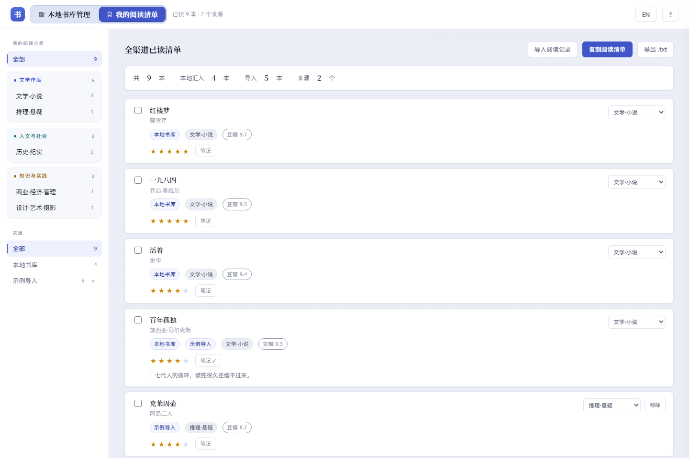

# 本地书库管理 · Ebooklib

> Turn a local ebook folder into a searchable, deduplicated catalog — entirely in your browser. Nothing is uploaded.

**Source Available · 源码可用** ｜ 单文件离线网页 ｜ 扫描只读 · 删除需逐份勾选 ｜ 零上传 · 零账号 · 零后端

[在线体验](https://sinejjj.github.io/ebooklib/) · [能做什么](#能做什么) · [两种用法](#两种用法) · [快速开始](#快速开始) · [License](#license)

把本地电子书库（mobi / epub / pdf / azw3 / kfx / txt …）变成一份可检索、可查重、可分类、可打分、可记笔记的网页清单。书单、评分、笔记全部留在你自己的浏览器里。

<details>
<summary><b>English · Quick start</b></summary>

**Ebooklib** turns a folder of local ebooks (mobi / epub / pdf / azw3 / kfx / txt …) into a searchable, deduplicated catalogue that runs entirely in your browser. Nothing is uploaded; no account, no backend.

**Get started**
1. Open the [online demo](https://sinejjj.github.io/ebooklib/) or double-click the downloaded HTML file.
2. Click **Choose folder** and grant read access. The browser scans it locally and builds the list.
3. Use **Sync local library** whenever you move or rename files.

**Language** — the UI ships in Chinese and English. Use the **EN / 中** button in the top bar; the online version follows your browser language automatically. Book titles, authors, paths and notes are never translated.

**What you can do**
- Copy selected titles and paste them into an AI to find similar books or reading sources
- Export a compact reading list (title · author · Douban score · my rating · my note) for personalised AI recommendations
- Rate books, track pages, keep notes and external links, mark books read
- See duplicate copies side by side (open **Library tools → Duplicates & cleanup** in the top bar), tick the ones to remove and delete them in one batch
- Full backup / restore moves your list, ratings and notes to another browser or computer

**Privacy & safety** — scanning and syncing are strictly read-only and the file list is never uploaded. Deletion is opt-in only: nothing is pre-selected, every full path is shown in bold and listed before you confirm, files are copied into an `.ebooklib-trash` folder before the originals are removed. A removed entry is gone from the list for good — the page keeps no deletion history or restore record. The cleanup page shows exactly where the quarantine folder is; one click copies that path so you can paste it into File Explorer's address bar and open it directly.

The rest of this README is in Chinese; the interface itself is fully bilingual.

</details>

## 三种典型用法

它不只是"一份书单"。常见的用法是这三件：

1. **把书名喂给 AI，找同类书源** — 在清单里勾几本，点「复制选中书名」，粘贴给 ChatGPT / Claude / DeepSeek 等：
   「这些是我读过的，找同类型的电子书来源」「帮我挑适合做讲书 / 短视频的书」。
   选书、找资料、做内容选题都省得自己一本本翻。
2. **让 AI 按你的口味推荐** — 点「导出我的阅读清单」，得到一份纯文本：
   书名 + 作者 + 豆瓣评分 + 我的评分 + 我的评价，已按分类分好组、编号连续。
   直接发给 AI，它看到的是你**真实读过、喜欢什么、为什么喜欢**，推荐就不再是泛泛的畅销书单。
3. **顺手把书库整理清楚** — 自动按目录归类、同名副本归并、分卷识别、扫描图册单独处理；
   文件改名或挪了位置，评分和笔记自动跟上。全程只读，不动原文件。

> 这三件事都不需要上传任何东西：复制和导出是你主动触发的本地动作，书库路径不出你的电脑。

## 两个页面

顶栏左上角是一个页面切换器，两个页面各管一件事，互不干扰：

| 页面 | 管什么 | 分类体系 |
|---|---|---|
| **本地书库管理** | 扫描/同步本地目录得到的书单：查重、分类、评分、笔记、删除 | 13 个题材类（按目录与书名自动归类） |
| **我的阅读清单** | 你在各种渠道读过的书：手动添加、文件导入、与本地已读自动汇入合并 | 同一套 13 类 |

两套分类严格隔离：给阅读清单改分类，不会动书库里的分类，反之亦然。阅读清单也不需要授权任何目录，纯浏览器存储。

**13 个题材类**按三个大组显示（大组只是侧栏的视觉分段，分类本身平级，没有二级层级）：

- **文学作品** — 文学·小说、科幻·奇幻、推理·悬疑
- **人文与社会** — 历史·纪实（含传记 / 回忆录）、地理·旅行、社会·文化、政治·军事、哲学·宗教、心理·认知
- **知识与实践** — 商业·经济·管理、科学·技术·自然、设计·艺术·摄影、个人成长·方法论

导入后会自动归类：先看常见书名表，再看题材关键词，最后看作者（余华 / 东野圭吾 / 霍金这类）。判不准的宁可留「未分类」，也不瞎猜。**未分类的书可以勾选一批、一次改成同一类**，不用一本本点。

**导入**支持 TXT / CSV / TSV / JSON（拖进页面或点选择都可以）。TXT 每行一本「书名 · 作者」，也能认 `作者 - 书名`、带评分/评价后缀的行；CSV/JSON 会按表头或字段名取书名、作者、评分、评价、ISBN、来源。行首的 `1.` `10、` `100)` 这类序号会自动剥掉（`1984`、`1Q84`、`三体2` 这类真书名不受影响）。同一个文件重复导入不会产生重复记录（按内容指纹判重）。

**合并**是三级优先：ISBN 相同 → 同一来源的同一条目 → 规范化书名 + 作者都一致。本地书库里已经标了「已读」的书，会自动出现在阅读清单里（标为「本地书库」来源），不需要你二次录入——本地删掉这本书，这条也随之消失。

**导出**得到一份给 AI 用的纯文本清单：按分类分组，每本两行（`[0001] 作者 · 书名` + `评分 9.6 | 我的评分：5 星 | 我的评价：…`），没有评价就不出现那一段。刻意不带路径、进度、出版社，方便直接丢给 AI 做阅读分析与推荐。

**评分与笔记是同一份数据**：书库卡片和阅读清单卡片上都能直接点星，两边立刻一致；「笔记」打开的是同一个抽屉，可写本地短记、挂外部笔记链接（任意 `http(s)://` 网页）、改单本作者显示名。来源是「本地书库」的书走完整本地抽屉，纯导入的书也能挂外部链接。豆瓣评分只是参考分，永远不会被当成你的评分。

## 界面预览

以下截图取自**当前版本**（2026-11），用的是内置的脱敏示例书单，不是真实藏书；分数、笔记均为演示数据。

**本地书库管理** — 顶栏两个页面切换，侧栏 13 类按三大组分段，书卡右侧四个按钮依次为
「已读 / 笔记 / 复制书名 / 复制路径」，「我的评分」是可直接点击的五角星。


**我的阅读清单** — 卡片上直接打星、开笔记小窗，并排显示豆瓣分、来源与分类；
「本地书库」来源的书与书库页评分、笔记双向同步。



<details>
<summary>开屏引导（点击展开）</summary>


</details>

## 能做什么

- **查重**：同名副本、分卷合集、扫描图册分开处理；不同卷不会被误判成重复。另会自动识别「**高度疑似完全重复**」——书名、作者、文件大小、格式完全相同但路径不同的副本（多年间 Kindle / 磁盘 / 移动硬盘 / 多台电脑反复复制最易造成的重复），在整理页用醒目标记提示，并支持「保留此路径」一键把其余副本加入待删，你仍可自行调整
- **书卡四个按钮**：已读 / 笔记 / 复制书名 / 复制路径，单列排齐。「复制书名」只复制书名，方便粘进聊天或搜索框；「复制路径」复制完整本地路径（浏览器读不到盘符时，填一次「书库根目录」即可），粘到资源管理器地址栏回车就能定位到这本书
- **检索 / 筛选**：书名、作者、分类、已读、我的评分、豆瓣评分、未匹配豆瓣；阅读清单另有独立的分类 / 来源筛选，「全部」同样可点
- **评分排序**：豆瓣评分 + 评价人数；匹配不上的书不造假数据，如实显示「未匹配」
- **内置评分包**：网页里预置了 1300+ 本常见书的豆瓣评分（Top250 + 二十个大类高分榜 + 已扫书库匹配结果）。这是**构建时内嵌的静态快照，离线、不再实时请求豆瓣**；只能覆盖能把书名+作者对上的书，对不上的书留空、绝不编造数据
- **个人信息**：我的五星、读了多少页、出版社、外部笔记链接、本地短记、已读 / 标签；**作者显示名可以单本改**（豆瓣只返回首位作者，合著 / 译者署名 / 你自己按「阿德勒《被讨厌的勇气》」这类命名归档的书，在「笔记」抽屉里改一次就按你的叫法显示，只影响这一本）
- **搬家识别**：文件挪了位置或改了名，评分和笔记跟着走
- **导出**：
  - **复制选中书名**：勾选几本后，在底部工具条点一次复制，直接粘贴给 AI 找同类书源 / 做选题（这是批量复制的唯一入口，单本复制用书卡上的「复制书名」）
  - **完整备份**（JSON）：书单 + 豆瓣评分 + 我的评分 + 阅读进度 + 标签 + 笔记，一个文件全带走，换电脑选「恢复」原样还原
  - **导出我的阅读清单**（TXT）：按分类分组，每本两行 —— `[0001] 作者 · 书名`，下一行是「豆瓣 / 我的评分 / 我的评价」（没写评价就不出现那一段）。刻意保持极简，方便直接丢给 AI（Claude / ChatGPT 等）做阅读分析和个性化推荐，不能拿来恢复书库
- **扫描严格只读**：扫描、同步、脚本一律只读，绝不修改、移动或重命名书库里的任何文件
- **中英界面**：顶栏「EN / 中」一键切换；在线版按浏览器语言自动选择。书名、作者、路径、笔记始终原样保留
- **重复与可删除**：顶栏「同步本地书库」右边的常驻按钮；重名组左右并列，逐份标出书名 / 作者 / 大小 / 完整路径（路径深色加粗高亮），由你自己勾选要删的份（默认全不选、不代判）。
  另有「**高度疑似完全重复**」组：同一本书在书名 / 作者 / 大小 / 格式完全一致、只是路径不同（不含文件内容哈希比对，依元数据判定）时归为一组，标「高度疑似完全重复 · 仅路径不同」；组内点「**保留此路径**」即把其余副本自动加入待删（仍可手动取消），不预选、不代你删、不替你决定保留哪一份。
  删除前二次确认并逐条列出路径，先复制进书库内 `.ebooklib-trash` 隔离目录（复制后会校验体积一致）再移除原文件；删除后即从书单彻底移除，不留恢复记录，隔离目录副本由你自己手动清空。
  页面顶部写明隔离目录的实际位置，**点一下路径即可复制**；浏览器读不到盘符，填一次「书库根目录」后复制的就是可粘贴到资源管理器地址栏、直接打开隔离文件夹的完整路径（填的内容只存你自己的浏览器）。删除完成后路径会自动带上本批次目录名

## 两种用法

### 在线版 · 零安装，打开就能用

访问 [GitHub Pages](https://sinejjj.github.io/ebooklib/)，在开屏引导里二选一：

- **先看看示例** — 内置 30 条脱敏示例数据，不授权任何目录即可体验完整界面
- **选择文件夹** — 选你的本地电子书目录，浏览器**纯前端**扫描，立刻生成书卡

在线版不提供豆瓣评分 / 简介 / 出版社：豆瓣没有 CORS 接口，页面内也不发起任何第三方请求。书卡会显示「未匹配」而不是编造数据。

> 请用 **Chrome / Edge 独立标签页**打开。内置预览面板是 iframe，浏览器会拦截目录选择；页面会给出「在新标签打开」提示。

### 完整版 · 含豆瓣评分

在本机跑一遍 Python 链路（见[快速开始](#快速开始)），得到 `data/library_final.json`：

- 点在线版工具栏的「**恢复**」载入这份 JSON（会按内容自动识别为书库数据），即得评分、简介、出版社
- 或双击生成的 `我的书库.html`，单文件离线使用，双击即开

两种来源可以随时切换，你打过的评分不会丢。

## 快速开始

需要 Python 3.9+（无第三方库）、Node.js（仅用于移植测试）。

```bash
cp config.example.json config.local.json
# 编辑 config.local.json 的 source_root，填你的书库绝对路径

python scripts/scan_library.py          # 只读扫描
python scripts/fetch_douban.py --full   # 首次联网抓豆瓣；之后可 --offline 用缓存
python scripts/postprocess.py           # 清洗合并
python scripts/build_html.py            # 生成单文件 HTML
```

Windows 用户可直接双击根目录的 `重新生成清单.bat`（自动探测 Python）。

## 数据流

```
书库(只读) → scan_library.py → data/books.raw.json
                             → data/douban_cache.json
            fetch_douban.py  → data/douban_enriched.json（键=相对路径）
            postprocess.py   → data/books.merged.json（稳定 id）
            build_html.py    → 我的书库.html / data/library_final.json
```

公开版页面由 `scripts/build_public.py` 生成到 `docs/index.html`，**完全不读 `data/`**，只用 `scripts/demo_library.json` 里的编造示例数据。

仓库维护者的发布流程与发布前自检见 [docs/PUBLISH.md](docs/PUBLISH.md)。

## 豆瓣抓取说明

- 仅使用公开的 `subject_suggest` 与图书详情页，无需登录。
- 内置限速与封禁探测；`--offline` 只用本地缓存不联网，`--online` 只补缺口。
- `--refresh-detail` 只重抓详情页补**出版社 / 页数**，可分批断点续跑。

## 个人数据 / 刷新不丢

| 内容 | 存在哪 |
|---|---|
| 书单本身（扫描或导入的） | IndexedDB `ebooklib_sync_v1` · `kv['userLibrary']` |
| 我的评分、阅读进度、已读 / 标签 / 分类覆写 / 隐藏 / 链接 | `localStorage['ebooklib_library_state_v3']` |
| 笔记正文 | IndexedDB `ebooklib_sync_v1` · `notes` |
| 我的阅读清单（手动条目 / 导入来源 / 合并结果） | `localStorage['ebooklib_reading_v1']` |

- 全部只存**当前浏览器 + 当前地址**，不进任何数据文件，不进成品 HTML，不上传。
- 同一个地址刷新页面，书单和评分都还在。切换书库来源只替换书单，个人数据一个键都不动。
- 页数分母优先级：**手填总页数 > 豆瓣页数 > 扫描图册张数**。
- 笔记 = 外部链接（Notion 等任意网页）+ 本地短记；链接只接受 `http(s)://`。
- 换设备 / 换浏览器 / 换端口：点「**完整备份**」存一个 JSON（书单和评分笔记都在里面），在新地址点「**恢复**」选它，一步还原；或点「数据体检」复制恢复码，用 `#recover=` 直接搬。

## 同步与「书被挪走了」

页面内「同步书库」用 File System Access API **只读**读取你选的文件夹。条目身份默认是相对路径，同步时做搬家识别：

| 情况 | 处理 |
|---|---|
| 文件名 + 体积都对上 | 自动认领为「已移动」，评分 / 进度 / 笔记跟着走 |
| 文件名对上但体积不同 | 进「待确认」，可手动认领 |
| 多个同名文件 | 进「待确认」（防同名不同内容认错） |
| 体积唯一但文件名变了 | 进「待确认」（疑似改名搬家） |
| 确实找不到 | 才从书单彻底移除（不留记录、不再显示） |

同步发现本地已删的书会直接从书单移除，不留记录；分类不会自动改。

## 隐私与安全边界

- **扫描链路**全程只读：脚本只用 `os.scandir` / `os.stat`，`scripts/verify_readonly.py` 用快照 diff 校验 0 改动。
- **唯一会改动文件的地方**是网页里的「重复与可删除」：必须由你逐份勾选 → 二次确认 → 浏览器请求写入权限后才执行；
  且先复制到书库内隔离目录并校验大小，再移除原件，隔离目录在后续扫描中会被跳过，不会被当成新书。工具不预选、不自动建议、不生成任何删除脚本。
- 页面不加载任何 CDN、字体、统计脚本，不发起任何第三方请求。
- 真实书单、豆瓣缓存、个人备份、本地绝对路径全部被 `.gitignore` 排除。
- 发布前跑 `python scripts/prepublish_check.py --strict`，模拟 `git add -A` 逐文件检查，0 处泄漏才通过。

## 项目结构

```
scripts/
  app_template.html    单文件网页模板（原生 JS，无框架无构建）
  scan_core.js         前端从零扫描：文件名解析 / 分类 / 查重 / 分卷
  exactdup.js          高度疑似完全重复识别 + 路径合法性校验（纯逻辑，浏览器与 Node 单测共用）
  readingmerge.js      阅读清单解析 / 三级合并 / 导出行生成（纯逻辑，浏览器与 Node 单测共用）
  bookclassify.js      13 类题材分类：常见书名表 + 题材关键词 + 作者白名单（纯逻辑）
  test_exactdup.js     查重逻辑单测（5040 条）
  test_readingmerge.js 阅读清单逻辑单测（126 条）
  test_bookclassify.js 分类逻辑单测（89 条）
  demo_library.json    脱敏示例书单（人工编造，不含真实数据）
  build_public.py      生成 docs/index.html，不读任何私有数据
  build_html.py        生成本地完整版 HTML
  prepublish_check.py  发布前隐私检查
  scan_library.py / fetch_douban.py / postprocess.py / audit.py / verify_readonly.py
docs/
  index.html           GitHub Pages 在线版
```

## License

**PolyForm Noncommercial 1.0.0** — **Source Available（源码可用）**。

- 允许：非商业目的的使用、复制、修改、再分发（须保留许可声明）
- 禁止：任何商业用途
- **商业授权（dual licensing）**：企业内部使用、付费产品、对外服务等，请在 [GitHub Discussions](https://github.com/sinejjj/ebooklib/discussions) 联系

完整条款见 [LICENSE](LICENSE)。Copyright (c) 2026 SINE.
